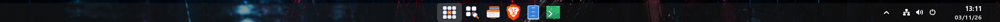
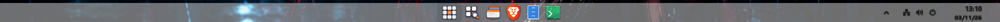
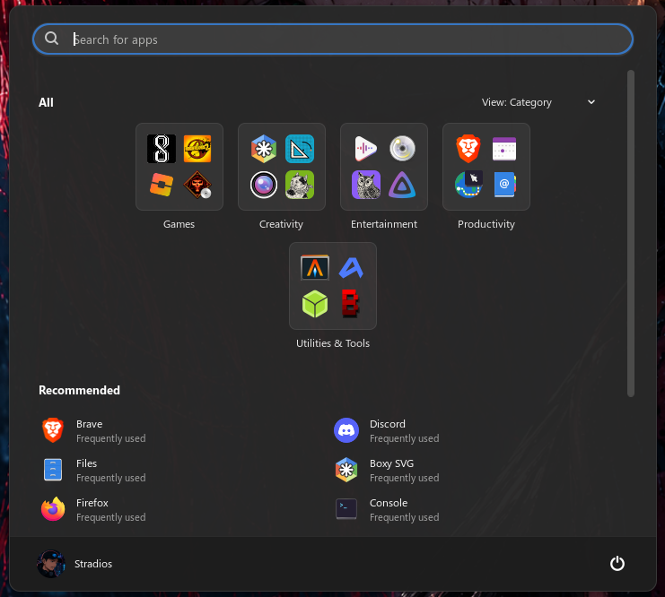
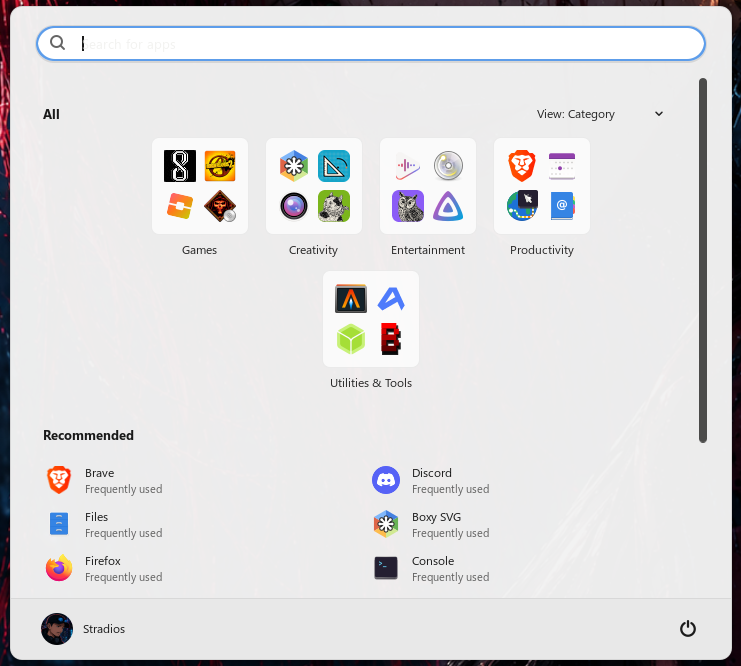

# 4ever

> **AI disclaimer:** This extension was created with the help of Claude, an AI assistant made by Anthropic.
> The design, testing and direction are by the repository owner. Review the code before relying on it.

<p align="center">
  
  
</p>
<p align="center">
  
  
</p>

A GNOME Shell extension that gives GNOME a familiar bottom-taskbar desktop: a centered Start menu,
a taskbar with running apps, a hidden-icons tray, a clock, and notifications at the bottom right.
Everything is configurable from the extension's settings window, so it replaces a stack of small extensions.

Works with GNOME Shell 50 and 51. Not affiliated with, or derived from, any other operating system's code or branding.

## Features

- **Taskbar** at the bottom: Start button, search (hidden / icon / box, with adjustable width and height),
  Task view button, pinned and running apps with a colored bar under running apps (color is configurable).
  Icon size, spacing and taskbar height are adjustable.
- **Start menu** centered on the screen: Pinned, Recommended and All apps (category / grid / list),
  reorderable sections, adjustable size, folders and spacing.
- **Search** for apps, files, folders and documents (uses GNOME's search providers). Enter opens the first result.
  Typing in the taskbar search box opens Start with the results.
- **Right-click menus** on apps show what the app offers (New window and its own actions) next to pin / unpin.
- **Account** name and picture come from your GNOME account.
- **Super key** opens and closes Start. It also shows the taskbar over full-screen apps while Start is open.
- **Hidden-icons tray** (arrow next to the system icons) listing background apps such as Discord or Telegram,
  in a grid or a list.
- **Show desktop** strip at the right end of the taskbar.
- **Multiple monitors**: an optional taskbar on every monitor, with separate switches for what it shows.
- **Clock** layout, time zone and formats; light, dark or system theme; independent transparency for the
  taskbar, the Start menu and the tray box; taskbar height, icon size and spacing.
- Bundled icon set for the Start button, search and Task view in transparent, dark, light or ember styles
  (transparent is the default), or use your distribution's logo or your own image for Start.
- Skips GNOME's overview after login and can hide the dash in Task view.

## What's new in 0.3

- Taskbar buttons only raise the app's window; the Start menu opens a new window.
- Clicking a taskbar app while Start is open in a game or full-screen app now works.
- One mark under the icon for each open window of an app (up to four).
- Hover preview: a card with a live thumbnail per window above the button. Click to raise, middle-click or X to close.
- New icon set for Start, search and Task view, sized to match app icons, and a new 4 logo.
- An About page in the settings (links, story, disclaimers) with a banner that follows light and dark.
- Separate icon size and spacing per Start, search and Task view button; icon spacing can be negative.

## What's new in 0.2

- Taller taskbar search box (36 px by default) with a new height setting.
- Bundled icon set (transparent, dark, light, ember) for Start, search and Task view.
- Search for files, folders and documents, not only apps.
- App right-click menus show New window and the app's own actions.
- Account picture and name in the Start menu.
- Hidden-icons tray: grid or list view, adjustable size, and it hides when nothing is running in the background.
- Show desktop strip, taskbar over full-screen apps while Start is open, multi-monitor taskbars.
- Running-app bar color, independent transparency, icon spacing and a highlighted Start button.

## Upcoming features

- A Pop!_OS 22.04 style look for the taskbar and desktop.
- A Pop!_OS style Start menu.

These are plans, not promises, and are not in the current version.

## Install

Download or build `4ever.zip`, then:

```sh
gnome-extensions install --force 4ever.zip
```

Log out and back in (on Wayland, new extensions load at login), then enable it:

```sh
gnome-extensions enable 4ever@4ever-extension.stradios
```

Open the settings from the extension manager, or right-click an empty part of the taskbar and choose
"4ever settings".

## Build

```sh
./build.sh
```

Needs `glib-compile-schemas` (from `glib2`/`libglib2.0-bin`) and `zip`.

## Notes

- The tray works through the StatusNotifierItem (AppIndicator) protocol. Apps that were already running when the
  extension loaded may need a restart before they appear in it.
- Start-menu pins are stored in `~/.config/4ever/start-pins.json`.
- If you used this extension under its earlier name (Eleven), disable and remove it first so the two don't run together.
  Your pins are picked up automatically.

## License

Add a license file before publishing. GNOME Extensions (extensions.gnome.org) requires a GPL-compatible
license, for example GPL-3.0-or-later.
